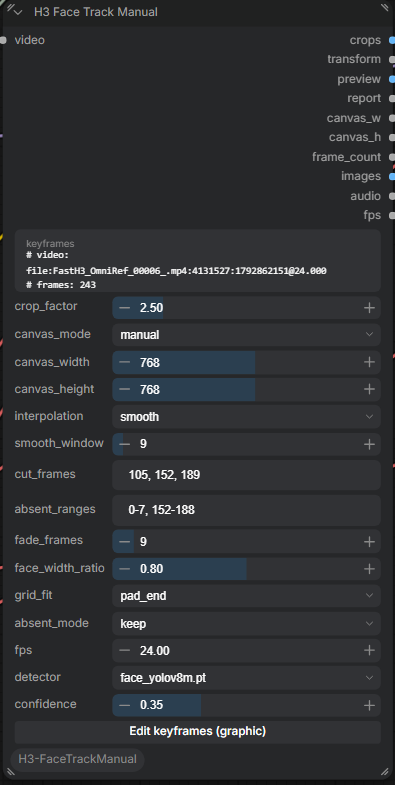
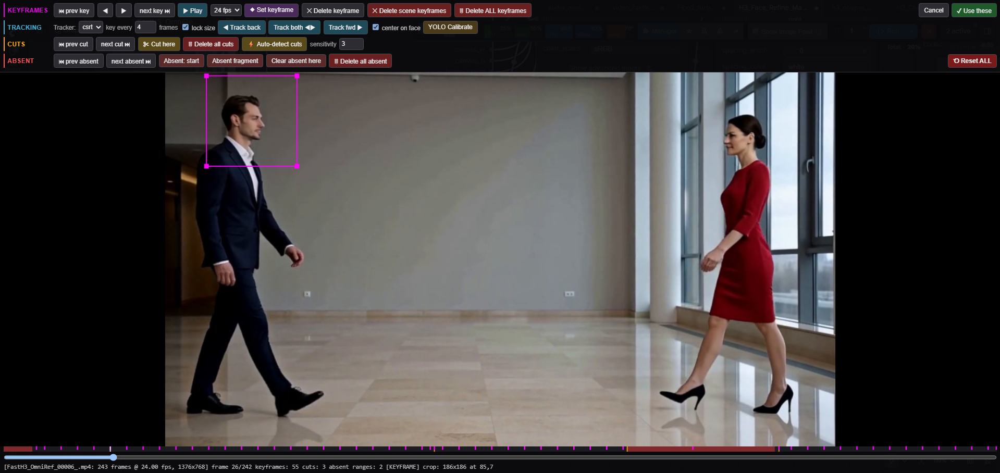

# ComfyUI-H3-FaceTrackManual

A hand-steered crop box for [ComfyUI-H3-FaceRefine](https://github.com/Carasibana/ComfyUI-H3-FaceRefine).

This is an add-on, not a replacement. You still need the original pack: its Inject Video Latent, Per-Frame Denoise, Face Stitch Back and mask nodes do all the real work, and this node's output plugs straight into them. The only thing swapped out is the step that finds the face and cuts the crop.

## Why this exists

Automatic face tracking is great when it behaves. On clips with several people, hard cuts, or someone walking in and out of frame, it can grab the wrong person, lose them after a cut, or slowly drift off the face. Fixing that from inside the automatic node is awkward, because you can't tell it "no, this one."

So this node flips it around: you place the crop box yourself on a few frames, and it fills in the rest. A tracker helps you do that quickly, and a YOLO pass can tidy up afterwards.

## What it does

- Takes a `VIDEO` straight from Load Video. It also works when Trim Video, Crop Video and similar nodes sit in between.
- Converts the video to a frame rate you choose (24 by default) and hands the converted `images`, `audio` and `fps` back out, so the rest of your graph works on exactly the same frames.
- Opens a graphic editor where you scrub or play the video, drag the crop box and set keyframes. Between keyframes the box moves smoothly.
- Can track the box forwards or backwards from any frame (CSRT, KCF or MIL), optionally letting the box grow and shrink with the head.
- Knows about shots: mark hard cuts by hand or auto-detect them, and tracking and smoothing never cross a cut.
- Lets you mark stretches where the subject isn't in the picture. Nothing gets pasted there, and the frames can be left out of the H3 run entirely to save time.
- **YOLO Calibrate** goes over your keyframes with a face detector, re-centres the box on the face and enlarges it if it's smaller than your `crop_factor` asks for. It never shrinks a box.
- Pads the clip to H3's 17k+5 frame count at the end, instead of letting H3 fill the gap with reference content.
- Notices when you load a different video (or change a trim) and clears the old keyframes, with an Undo button in case that was a mistake.

The `transform` it produces uses the same format as the original Face Track node, so Per-Frame Denoise, Face Stitch Back and the SAM mask node accept it as is.

## The editor

Four rows of buttons, one per job: keyframes, tracking, cuts and absent stretches. The strip along the bottom shows everything at a glance: pink ticks are keyframes, orange are cuts, red are absent ranges. The line under it shows the frame count, fps and what's currently selected.

A couple of optional bits:

- YOLO Calibrate uses the same face detector models as the original pack, so the model dropdown on the node should already list them.
- CSRT and KCF trackers need `opencv-contrib-python`. Without it the tracker quietly falls back to MIL.
- PySceneDetect, if installed, is used for auto-detecting cuts. Otherwise a simpler built-in detector takes over.

## Quick start

1. Load Video → **H3 Face Track Manual** (`video` input).
2. Wire the outputs where the original Face Track node's went: `crops` to Inject Video Latent, `transform` to Per-Frame Denoise and Face Stitch Back, `canvas_w` / `canvas_h` / `frame_count` to the H3 node. `images` is the base video for Face Stitch Back.
3. Click **Edit keyframes (graphic)**. Click on the image to drop a crop box over the head, then hit **Track both**.
4. Scrub or play through, fix the places where it slipped, optionally run **YOLO Calibrate**, then **Use these**.
5. Run the graph.

## Credits

Built as a companion to [ComfyUI-H3-FaceRefine](https://github.com/Carasibana/ComfyUI-H3-FaceRefine) by Carasibana. All the face-refinement work, the transform format and the H3 plumbing are theirs; this just gives you a manual way to point the crop.
